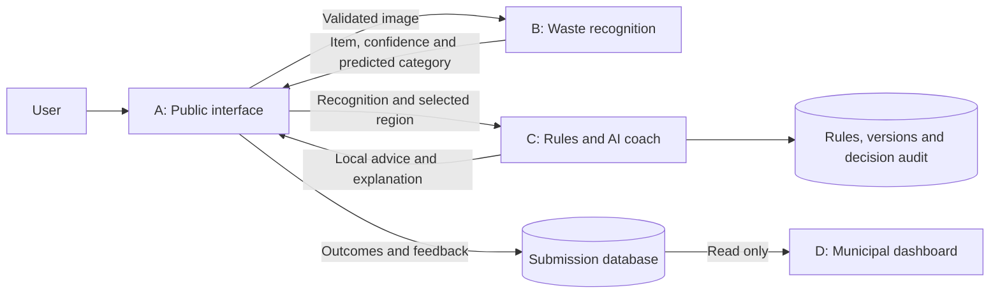
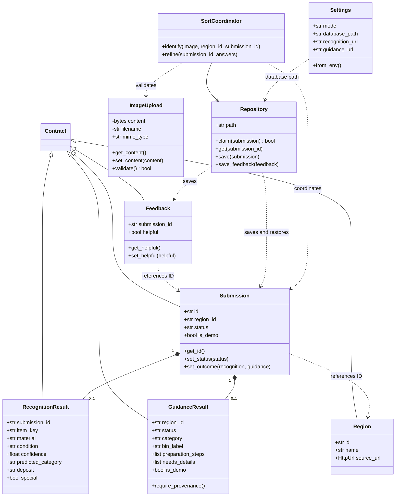
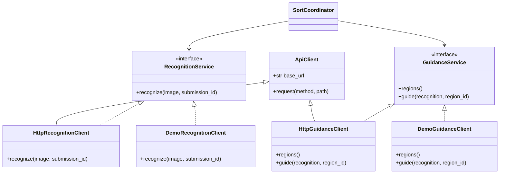
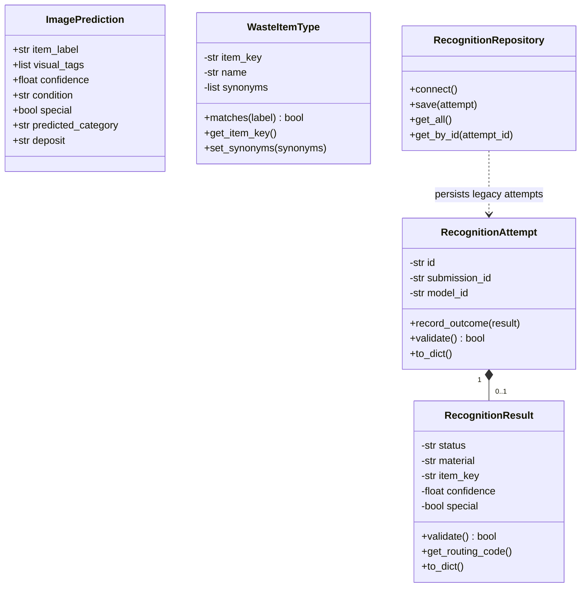
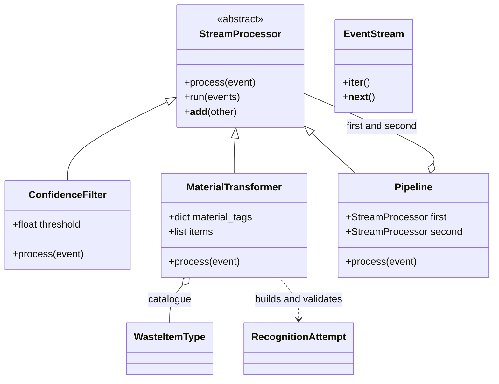
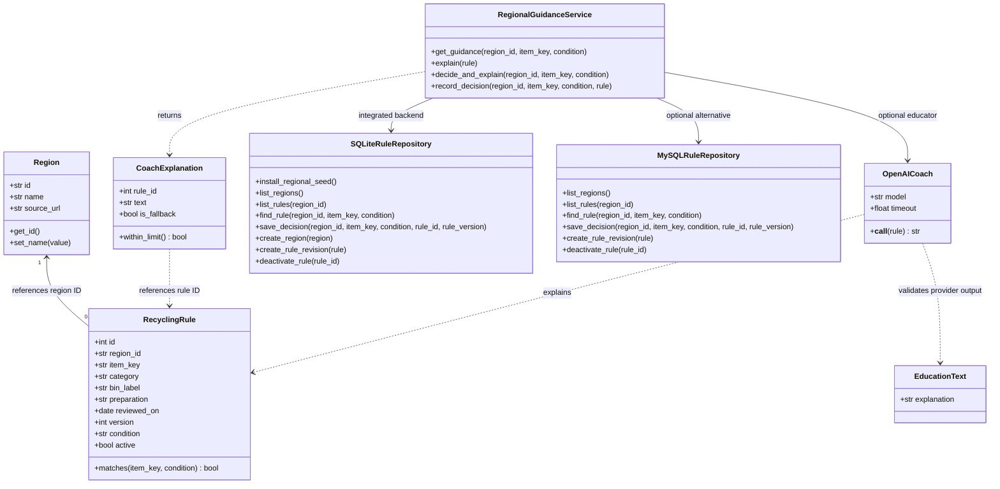
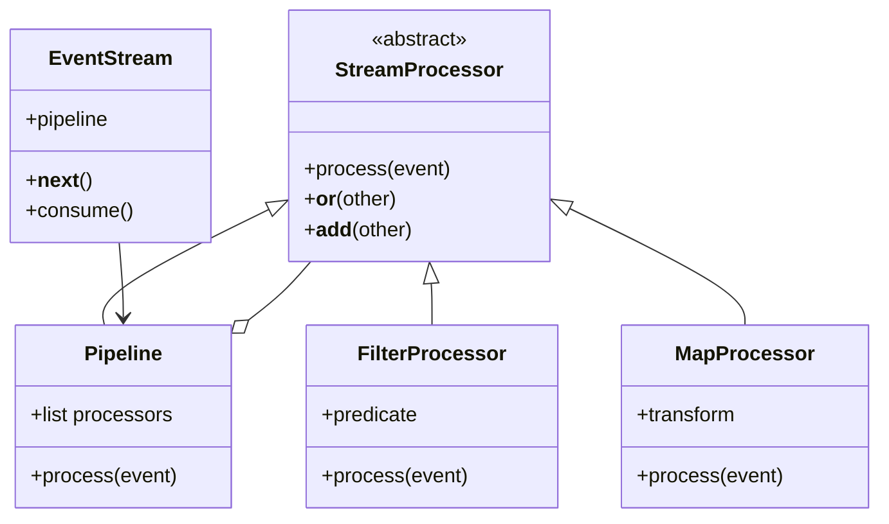
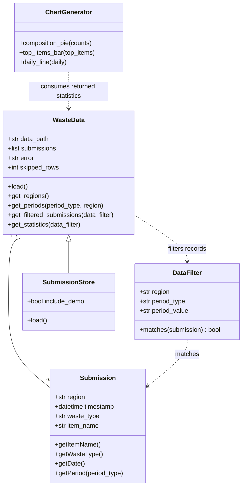

# ReSort — AI-Powered Waste Sorting & Recycling Assistant

ReSort identifies household waste from a photo, combines the recognition with regional recycling rules, explains the result, and records disposal decisions for municipal statistics.

This README is the central guide for all four subsystems. Class diagrams use Mermaid; GitHub renders them directly. Diagrams show the application classes and important relationships, with representative attributes and methods rather than every accessor. The separate `Submission`, `Region` and `RecognitionResult` classes in different subsystems belong to different modules and are not interchangeable Python objects.

## Assignment 4 · Exception handling and unit tests

| Subsystem | Exception class | Application behavior |
| --- | --- | --- |
| 1 · Public interface | [`UploadError`](web%20interface/src/waste_sorting/uploads.py), [`ServiceError`](web%20interface/src/waste_sorting/services/clients.py) | Rejects invalid images and reports failures from downstream services. |
| 2 · Waste recognition | [`RecognitionError`](WasteRecognition/recognition_errors.py) | Flask returns JSON with the appropriate status for malformed inputs, oversized images and provider failures. |
| 3 · Regional rules and AI coach | [`SubsystemError` hierarchy](ai-coach/app/domain/errors.py) | Flask converts domain and persistence errors into structured JSON responses. |
| 4 · Municipal dashboard | [`SubmissionStorageError`](subsystem4_dashboard/dashboard/errors.py) | The dashboard catches SQLite read failures, shows a storage message and reports unavailable storage from the API and health check. |

Run the documented test suite from the repository root after installing dependencies.

```powershell
.\.venv\Scripts\python.exe test_all.py
```

Verified **118 passing tests** across the four subsystems and the combined suite. See the [recognition event tests](tests/test_integration.py) and [dashboard storage tests](subsystem4_dashboard/tests/test_submission_store.py) for coverage of the new error handling.

[GitHub submission branch](https://github.com/adelbasalama/Resort/tree/HomeworkAssignment4)

## Team overview

**Group 8 · MDT · Waste Sorting & Recycling Assistant**

| Team member | Assigned subsystem | Classes for the OOP demonstration |
| --- | --- | --- |
| Adel Abasalam Esmail Basalama | 1 · [Public interface](#4-subsystem-a--public-web-interface) | `ImageUpload`, `Submission`, `Feedback` |
| Mahdi Yahia | 2 · [Waste recognition](#5-subsystem-b--waste-recognition) | `WasteItemType`, `RecognitionResult`, `RecognitionAttempt` |
| Jayesh Patil | 3 · [Regional rules and AI coach](#6-subsystem-c--regional-rules-and-ai-coach) | `Region`, `RecyclingRule`, `CoachExplanation` |
| Rashi Jain | 4 · [Municipal dashboard](#7-subsystem-d--municipal-dashboard) | `Submission`, `DataFilter`, `WasteData` |

## 1. Project structure and data flow

| Subsystem | Directory | Role | Default address |
| --- | --- | --- | --- |
| A — Public interface | `web interface/` | Photo upload, request coordination, results, follow-up questions and feedback | http://localhost:8501 |
| B — Waste recognition | `WasteRecognition/` | OpenAI image analysis and validated recognition facts | Internal Docker service; local port 5001 |
| C — Regional rules and AI coach | `ai-coach/` | Rule lookup, OpenAI education, regional configuration and administration | http://localhost:5002/admin |
| D — Municipal dashboard | `subsystem4_dashboard/` | Composition, recycling rate, item counts and time/region filters | http://localhost:5003 |



The AI predicts the item and broad waste category. The regional rule supplies the final disposal instructions. Uncertain or unsupported recognition does not receive a guessed bin. Deposit markings and paper condition can trigger follow-up questions; answering reuses the original recognition.

## 2. Start with Docker

Requirements: Docker Desktop running with Linux containers, and an internet connection for the first image build and live OpenAI requests. Run commands from the project root. The examples below use PowerShell.

On a new checkout, create the private configuration file without overwriting an existing one:

```powershell
if (!(Test-Path .env)) { Copy-Item .env.example .env }
```

Edit `.env` locally:

```dotenv
OPENAI_API_KEY=your_private_key
OPENAI_MODEL=gpt-4.1-mini
OPENAI_COACH_MODEL=gpt-4.1-mini
ADMIN_API_TOKEN=your_long_private_admin_password
```

Keep actual secrets out of source control. `OPENAI_API_KEY` enables real photo recognition and OpenAI educational explanations. Without a key, illustrated examples and rule lookup still work; photo recognition returns a service error and education uses deterministic fallback text. `ADMIN_API_TOKEN` protects rule changes.

Build and start all four parts together:

```powershell
docker compose up --build -d
docker compose ps
```

Open the public interface, select a region, then upload a clear photo of one item. Alternatively choose **Try an example** to explore the interface without a paid image request. Open the dashboard and select **Include demo data** to see illustrated-example outcomes. Normal statistics exclude demo outcomes.

Useful commands:

```powershell
# Follow service logs
docker compose logs -f

# Show the latest messages from the recognition service
docker compose logs --tail=100 recognition

# Apply code or dependency changes
docker compose up --build -d

# Apply changed environment values
docker compose up -d --force-recreate

# Stop while preserving the databases
docker compose down
```

Do not start `python run.py` at the same time as Docker on the same ports. Do not use `docker compose down -v` unless you intend to delete persistent databases. `WEB_PORT`, `GUIDANCE_PORT` and `DASHBOARD_PORT` in `.env` change the published host ports; service-to-service Docker URLs stay internal.

## 3. Start with local Python

Python 3.11+ is supported; the project was tested with Python 3.12. On a new setup:

```powershell
python -m venv .venv
.\.venv\Scripts\python.exe -m pip install -r requirements-lock.txt
if (!(Test-Path .env)) { Copy-Item .env.example .env }
python run.py
```

The launcher automatically selects the project's `.venv`, reads the root `.env`, checks ports, starts all four processes, waits for readiness and writes logs under `logs/`. Ctrl+C stops the processes. If the `python` command is unavailable, use your installed Python executable or `py -3.12` to create the environment.

## 4. Subsystem A — Public web interface

**Entry point:** `web interface/app.py`. **Core code:** `web interface/src/waste_sorting/`.

The Streamlit application validates JPEG/PNG uploads, gets regions from C, calls B and then C, displays the result, and stores metadata and feedback. Photo bytes stay in memory. `ImageUpload` checks extension, real image format, size and dimensions. `SortCoordinator` atomically claims a submission ID through `Repository`, avoids repeating recognition for the same ID, validates response identity, and skips guidance below 0.80 confidence. `refine()` submits additional facts to C without another image call.

### Domain and storage classes



`Contract` is a Pydantic base model. Submission and feedback have explicit constructors and accessors; their validation and JSON persistence remain supported. `UploadError` and `ServiceError` represent image and service failures.

### Service adapters



The interfaces are Python protocols: concrete clients conform structurally rather than explicitly inheriting from them. Connected examples use fixture recognition and the real C service, while remaining marked as demo outcomes. A's JSON contracts and exported machine-readable schemas are in `models.py` and `web interface/docs/schemas/`; regenerate with:

```powershell
.\.venv\Scripts\python.exe "web interface/scripts/export_schemas.py"
```

## 5. Subsystem B — Waste recognition

**Entry point:** `WasteRecognition/app.py`. **Live recognition:** `WasteRecognition/image_recognizer.py`.

`POST /v1/recognitions` accepts multipart fields `image` and `submission_id`. It validates/sanitizes the photo, calls OpenAI with a structured `ImagePrediction`, and normalizes the result to A's response contract. JPEG/PNG files are limited to 10 MiB and 25 megapixels, resized to a maximum dimension of 1024 pixels, and re-encoded without EXIF before the provider call. Photos are not saved by the application.

Supported items: plastic bottle, ordinary plastic packaging container, beverage can, banana peel, battery, paper bag, glass bottle, cardboard, newspaper, coffee grounds, used tissue, disposable diaper and ceramic cup. Predictions include confidence, condition, broad waste category, deposit status and special handling. Unknown materials, conflicting facts or low confidence remain uncertain/unsupported. `GET /health` reports service readiness and whether a recognition key is configured.

### Recognition and domain classes



`ImagePrediction` is the validated OpenAI output model. The live path uses module functions `prepare_image()`, `recognize_image()` and `recognize_contract()`; these are functions, not classes. The diagram's `RecognitionResult` is B's legacy domain class, distinct from A's Pydantic contract.

### Conveyor stream-processing classes



The conveyor stream reads predictions lazily through `EventStream`. `ConfidenceFilter(0.80) + MaterialTransformer()` drops predictions below 0.80, maps visual tags to PET, HDPE or aluminum, and computes detection area from a normalized `bbox` of `[left, top, right, bottom]`. A box covering less than 1% of the frame sends the item to `REVIEW`, even when the tags suggest a material. Predictions without a box retain their original routing behavior. The 1% threshold is a demonstration setting for the simulated sorter.

Run `python WasteRecognition/hometask2_waste_stream.py` from the repository root for a deterministic example. The same pipeline serves `POST /events`. That endpoint and the older `/recognize` and `/recognitions` routes use the recognition MySQL repository for stored results. Configure `DB_HOST`, `DB_PORT`, `DB_USER`, `DB_PASSWORD` and initialize `WasteRecognition/schema.sql` through `database.py` to use those routes. The integrated photo endpoint, `POST /v1/recognitions`, returns its result to the public interface for storage. `RecognitionError` maps invalid uploads, malformed conveyor events and provider failures to HTTP responses.

## 6. Subsystem C — Regional rules and AI coach

**Application factory:** `ai-coach/app/main.py`. **Routes:** `ai-coach/app/web/routes.py`. **Rule dataset:** `ai-coach/seeds/regional_rules.json`.

C owns regional disposal decisions. `RegionalGuidanceService` reads a matching rule, asks `OpenAICoach` for an explanation when configured, and records the selected rule/version in the decision audit. OpenAI text cannot change the stored category/bin fields. Failed, overlong or invalid generated explanations fall back to deterministic text. A missing rule produces an explicit result without fabricated collection advice.

### Rules, repositories and education classes



SQLite and MySQL repositories implement the same expected operations through duck typing; neither inherits from the other. The integrated setup uses SQLite. The legacy MySQL option uses `RULES_BACKEND=mysql`, `MYSQL_HOST`, `MYSQL_PORT`, `MYSQL_USER`, `MYSQL_PASSWORD`, `MYSQL_DATABASE`, and `ai-coach/sql/schema.sql`; its standalone seed is separate from the seven-region SQLite dataset.

C also retains a small streaming exercise in `app/streaming/pipeline.py`:



`RuleNotFoundError` and `CoachProviderError` cover lookup/provider failures. `SubsystemError` is the base for invalid guidance/rule requests, authorization, guidance-unavailable and persistence errors.

### Administration and API

Open http://localhost:5002/admin to inspect rule IDs, sources and versions. Supply the `ADMIN_API_TOKEN` from your private `.env` to add a region, save a new rule revision or deactivate a rule. A revision replaces the active rule for the same region/item/condition while retaining historical versions. Use canonical item keys; deposit-return variants use `_deposit`.

| Endpoint | Purpose |
| --- | --- |
| `GET /v1/regions` | Regions available to A |
| `GET /v1/rules` | Active rules and source links for the selected region in D |
| `POST /v1/guidance` | Nested recognition facts to local disposal advice |
| `GET /admin`, `POST /admin` | Rule administration page and token-protected changes |
| `POST /api/admin/regions` | Token-protected region creation |
| `POST /api/admin/rules` | Token-protected rule revision |
| `DELETE /api/admin/rules/<id>` | Token-protected deactivation |
| `POST /api/guidance` | Original flat-input guidance API |

The v1 response carries category, bin label, preparation, explanation, provenance, fallback/demo flags and any requested details. Deposit answers are yes/no/unknown; paper condition is clean/soiled/unknown. Special recognition never receives ordinary matched-bin advice.

## 7. Subsystem D — Municipal dashboard

**Entry point:** `subsystem4_dashboard/app.py`. **Classes:** `subsystem4_dashboard/dashboard/`.

D reads A's SQLite outcomes using a read-only connection. `SubmissionStore` adapts those records to the same statistics interface as `WasteData`, which retains CSV support. `DataFilter` applies region and month/year/ISO-week filters. `ChartGenerator` builds Plotly composition, top-item and daily-count charts; the matching JavaScript is served locally.

The sidebar links to **Dashboard**, **Submissions** and **Region Rules**. Dashboard shows analytics filters and charts. Submissions lists saved statuses with search, region filtering and pagination. Its last column shows feedback and stays blank when no feedback was submitted. Region Rules uses `GUIDANCE_API_URL` to display a read-only catalogue of active rules, including the condition, disposal instructions, source and version.



Only completed outcomes with matched/special guidance contribute to disposal statistics. Failed, uncertain, unsupported, pending-detail and missing-rule outcomes are excluded. Demo outcomes are excluded unless selected. Timestamps are normalized to UTC. `GET /api/stats` returns the filtered statistics; `/health` is the readiness endpoint. Set `DASHBOARD_CSV_PATH` only when intentionally using the original CSV path instead of live storage.

`SubmissionStorageError` wraps SQLite read failures. The dashboard reports unavailable storage while preserving the healthy empty state before any submissions exist.

## 8. Databases and regional coverage

| Data | Local Python | Docker storage | Tables |
| --- | --- | --- | --- |
| Regional rules | `data/rules.sqlite3` | Named `rules` volume | `regions`, `recycling_rules`, `guidance_decisions`, `seed_datasets` |
| Outcomes/feedback | `data/waste_sorting.sqlite3` | Named `submissions` volume | `submissions`, `feedback` |

D opens the submission database read-only (`mode=ro`, with query-only enforcement). Its Docker volume permits SQLite to create the WAL/shared-memory sidecar files needed after a restart; a filesystem-read-only mount can prevent opening a WAL database when those files do not exist. D does not write submission records. Local Python and Docker use separate databases. Application photo bytes and original filenames are not persisted; outcome records contain UUIDs, region, status, timestamps, recognition/guidance JSON and optional feedback. Rule audits preserve the rule/version used at the time of the decision.

The bundled dataset contains **133 source-linked rules across seven regions**: Dortmund, Bochum, Hagen, Witten, Unna, Lünen and Castrop-Rauxel. Each has 19 rules including condition-specific paper and deposit-return variants. A separate `demo-dortmund` region has seven fixtures. The JSON source is tracked with the application; SQLite installs its version once on fresh and existing volumes without silently overwriting administrator changes.

### Rule sources and limits

Sources were checked on **7 November 2026**. Rules are English paraphrases of provider guidance, not municipal endorsements. Each rule has its own source URL, source-check date and version; the JSON also contains a source register.

| Region | Primary sources |
| --- | --- |
| Dortmund | [EDG Abfall-ABC 2026](https://www.edg.de/de/medien/pdf/download/abfallabc_2026.pdf?mtd=a), [Bioabfall](https://www.edg.de/de/entsorgungsdienstleistungen/rein-damit/bioabfall.htm) |
| Bochum | [USB sorting guide](https://www.usb-bochum.de/wp-content/uploads/2025/06/Trennen-leicht-gemacht_barrierefrei_DE.pdf), [city waste information](https://www.bochum.de/Umwelt--und-Gruenflaechenamt/Dienstleistungen-und-Infos/Abfallentsorgung) |
| Hagen | [HEB sorting guide](https://www.heb-hagen.de/images/2024/PDF/HEB%20Abfall-Flyer_A5_komplett_WEB_Doppelseite.pdf), [kitchen waste](https://heb-hagen.de/rund-um-den-muell/standorte/abfallarten/kuechenabfaelle.html), [residual/paper guidance](https://www.heb-hagen.de/einfache-sprache.html) |
| Witten | [city calendar 2026](https://www.witten.de/medien/dokumente/abfallkalender_2026_web.pdf?20251210160510=), [sorting leaflet](https://www.witten.de/medien/dokumente/faltblatttipps_zur_abfalltrennung_2014.pdf?20240703075115=) |
| Unna | [Stadtbetriebe Unna](https://www.stadtbetriebe-unna.de/entsorgung/biomuell), [GWA sorting information](https://www.gwa-online.de/service/abfallberatung/abfallentsorgung/) |
| Lünen | [WBL sorting guide](https://wbl.de/abfallentsorgung/abfalltrennung) |
| Castrop-Rauxel | [EUV recycling guidance](https://www.euv-stadtbetrieb.de/entsorgung-recycling/abfall-richtig-entsorgen/wertstoffe) and its paper, bio, residual and glass pages |

Shared national guidance covers [household batteries](https://www.umweltbundesamt.de/umwelttipps-fuer-den-alltag/batterien-akkus-richtig-nutzen-fachgerecht) and [deposit return](https://www.bundesumweltministerium.de/presse/fragen-und-antworten-faq/cluster/einweg-und-mehrweg).

This is a limited household-item catalogue, not an exhaustive Abfall-ABC. Witten's PDFs blocked direct download during preparation; indexed city-published contents were used, not a full downloaded-document audit. Hagen's kitchen-waste rules refer to HEB collection facilities; Bochum's Bio route assumes an available Biotonne. Paper `soiled` means heavy food/grease contamination. The assignment category `landfill` means residual waste in this application, not a claim that German residual waste physically goes to landfill. Recheck source guidance when maintaining rules.

### Back up or restore project data

Use the SQLite backup utility rather than copying a live database file without its committed WAL changes. Pick a new output filename for each export:

```powershell
docker compose --profile tools run --rm --build database-tools export rules /backups/rules-export.sqlite3
docker compose --profile tools run --rm database-tools export submissions /backups/submissions-export.sqlite3
```

Files appear in the host `backups/` directory. To inspect a snapshot:

```powershell
docker compose --profile tools run --rm database-tools inspect rules /backups/rules-export.sqlite3
```

To restore rules, stop their owning service first:

```powershell
docker compose stop guidance
docker compose --profile tools run --rm database-tools import rules /backups/rules-export.sqlite3
docker compose up -d guidance
```

Imports check integrity, expected tables and foreign keys and back up the previous database next to the input snapshot. To restore submissions, stop `public-interface` and `dashboard`, use kind `submissions`, then start both again. Local equivalents use `.venv\Scripts\python.exe tools/databases.py` with the same arguments and a local snapshot path. `tools/build_regional_seed.py` regenerates the JSON; deploying changed seeds requires a new dataset version or explicit admin revisions.

## 9. Tests and troubleshooting

```powershell
.\.venv\Scripts\python.exe test_all.py
```

The runner isolates the suites to avoid overlapping Python module names. Tests use temporary databases and controlled provider outputs without making paid AI calls. Coverage includes conveyor filtering and routing, recognition input errors, dashboard read-only WAL access and storage failures, feedback, regional rules, and the integrated photo-to-guidance flow.

| Problem | Action |
| --- | --- |
| Docker engine connection fails | Start Docker Desktop and wait for the Linux engine |
| Port already in use | Stop the other local/Docker instance, or change host ports in `.env` |
| Recognition unavailable | Check `OPENAI_API_KEY` and `docker compose logs --tail=100 recognition` |
| Configuration changed but behavior did not | Recreate containers with `docker compose up -d --force-recreate` |
| Rule missing or details unknown | Answer only facts you can establish, or consult the cited provider |
| Dashboard empty | Complete a matched/special decision; select Include demo data for examples |
| Admin edits rejected | Check `ADMIN_API_TOKEN` in the private `.env` |

Exposed services bind to localhost. Public deployment requires production serving, HTTPS, access control for municipal analytics and operational monitoring. Keep SQLite on a local filesystem; distributed replicas need an appropriate database/API boundary.
