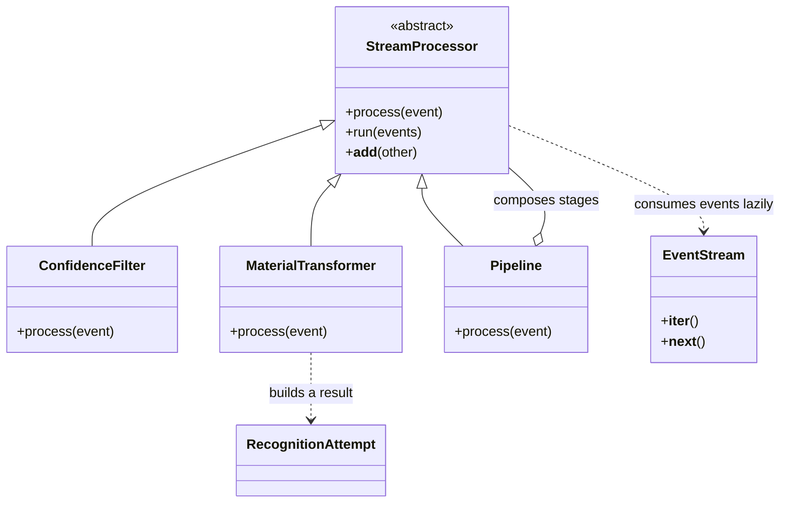

# ReSort · Assignment 2 · Real-time data processing

The [conveyor pipeline](WasteRecognition/hometask2_waste_stream.py) processes simulated optical sorter events lazily using Python's standard library. It uses the [recognition domain](WasteRecognition/hometask1_waste_recognition.py) to validate results and derive routing codes.

## Run the sorter

From the repository root with Python 3.11 or newer:

```powershell
python WasteRecognition/hometask2_waste_stream.py
```

The pipeline discards predictions below 0.80 confidence. It maps visual tags to PET, HDPE or aluminum and uses the area of a normalized bounding box, `[left, top, right, bottom]`, to divert detections covering less than 1% of the frame to review. The threshold is a demonstration setting.

| Sample | Expected result |
| --- | --- |
| `attempt_001` | PET → `LANE_1` |
| `attempt_002` | Discarded at 0.60 confidence |
| `attempt_003` | HDPE → `LANE_2` |
| `attempt_004` | Aluminum → `LANE_3` |
| `attempt_005` and `attempt_006` | Unsupported or conflicting tags → `REVIEW` |
| `attempt_007` | Same tag and confidence as `attempt_001`, smaller box → `REVIEW` |

## Stream design



`@abstractmethod` defines the shared contract. The concrete processors override `process()`. `ConfidenceFilter(0.80) + MaterialTransformer()` composes the stages via `__add__`. `EventStream` wraps an input generator with the iterator protocol, and `run()` yields each accepted result on demand.

## Pipeline presentation

**Video link pending.** In the 5-minute demo, explain the diagram and the composition operator, run the sample, show why the low-confidence event is absent, and compare the two PET events. Add the direct video link here before submitting.
