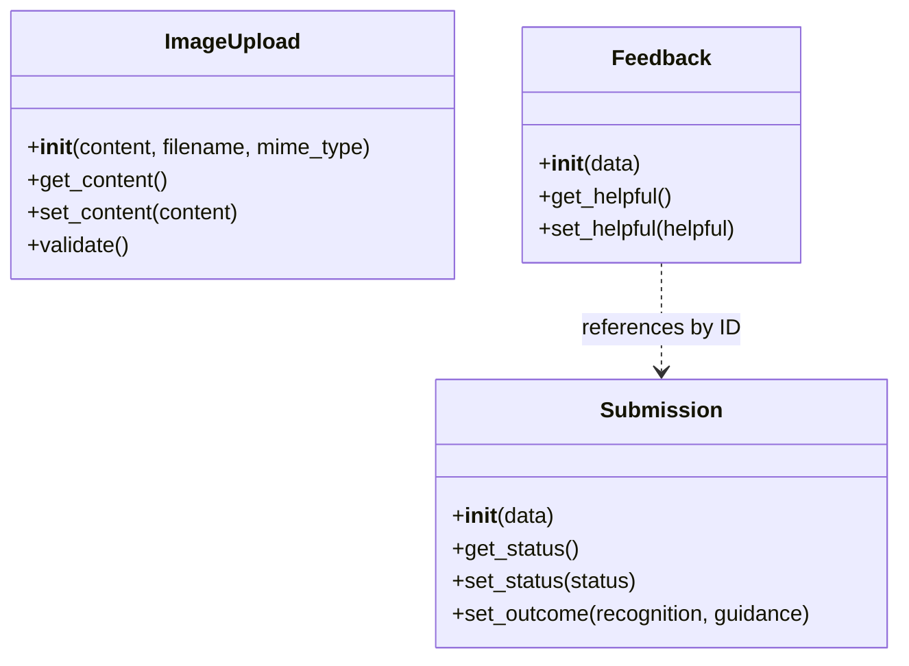
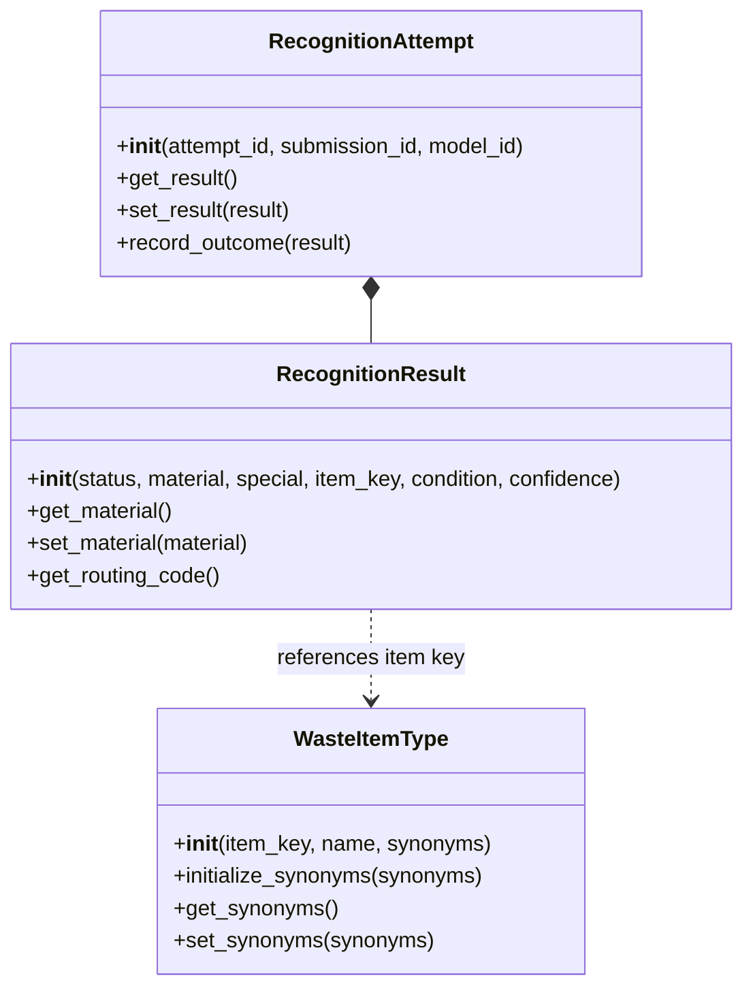
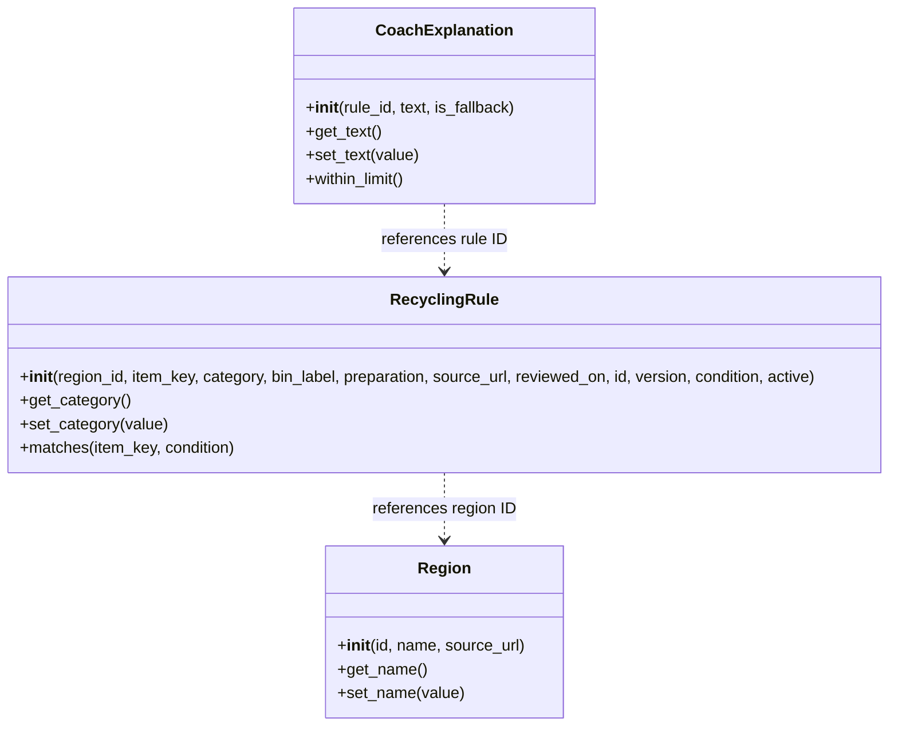
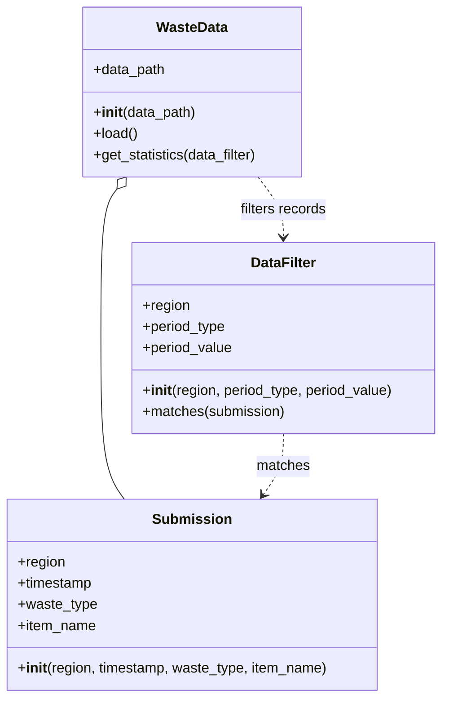

# ReSort · Assignment 1 · Object-oriented concepts

**Group 8 · MDT · Waste Sorting & Recycling Assistant**

| Team member | Assigned subsystem | Classes |
| --- | --- | --- |
| Adel Abasalam Esmail Basalama | [1 · Public interface](#1-public-interface) | `ImageUpload`, `Submission`, `Feedback` |
| Mahdi Yahia | [2 · Waste recognition](#2-waste-recognition) | `WasteItemType`, `RecognitionResult`, `RecognitionAttempt` |
| Jayesh Patil | [3 · Regional rules and AI coach](#3-regional-rules-and-ai-coach) | `Region`, `RecyclingRule`, `CoachExplanation` |
| Rashi Jain | [4 · Municipal dashboard](#4-municipal-dashboard) | `Submission`, `DataFilter`, `WasteData` |

## Run the class examples

Use Python 3.11 or newer. From the repository root in PowerShell:

```powershell
python -m pip install -r requirements.txt
python WasteRecognition/hometask1_waste_recognition.py

$env:PYTHONPATH = 'web interface/src;ai-coach;subsystem4_dashboard'
python -c "from waste_sorting.models import Submission, Feedback; request = Submission(region_id='dortmund'); print(Feedback(submission_id=request.get_id(), helpful=True))"
python -c "from app.domain.models import Region; region = Region('dortmund', 'Dortmund', 'https://www.dortmund.de'); print(region.get_name())"
python -c "from dashboard.submission import Submission; from dashboard.data_filter import DataFilter; print(DataFilter(region='Dortmund').matches(Submission('Dortmund', '2026-11-07T12:00:00', 'recyclable', 'Can')))"
Remove-Item Env:PYTHONPATH
```

The examples run locally with no service credentials. The diagrams show representative constructors, accessors, and class relationships.

## 1. Public interface

[Upload class](web%20interface/src/waste_sorting/uploads.py) · [Submission and feedback](web%20interface/src/waste_sorting/models.py)



## 2. Waste recognition

[Recognition domain classes](WasteRecognition/hometask1_waste_recognition.py)



## 3. Regional rules and AI coach

[Regional guidance domain classes](ai-coach/app/domain/models.py)



## 4. Municipal dashboard

[Dashboard classes](subsystem4_dashboard/dashboard/)



Dashboard properties use getters and setters to normalize input. Setting `WasteData.data_path` reloads the CSV source.

## Team presentation

**Video link pending.** Record one 3–5 minute presentation. Each member should show their three classes, explain the corresponding UML, and demonstrate a constructor, a configuration or validation step where applicable, and a getter or setter. Add the direct video link here before submitting.
