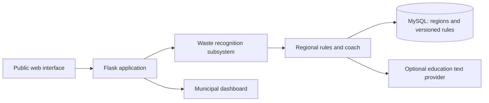
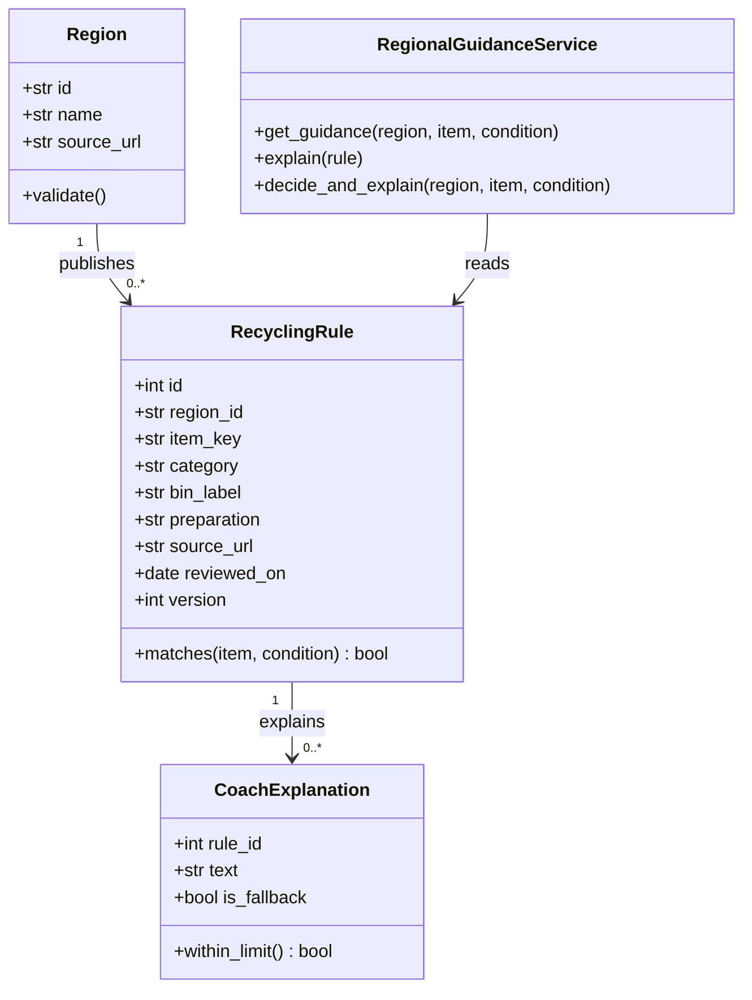

# AI-Powered Waste Sorting & Recycling Assistant

A capstone MVP for photo-based waste recognition and region-specific disposal guidance. This repository currently implements **Subsystem C (Jayesh): Regional rules and education** plus the shared streaming exercise used in Homework 2. It includes a Flask/MySQL application path for Homework 3 and unit tests for Homework 4. Recognition, public image upload, and the municipal dashboard are integration points for the other team subsystems.

> Seed rules are demonstration data. Replace and review them against official local sources before presenting them as current local advice. The application never uses generated text to change the disposal decision.

## Team and subsystem ownership

| Member | Subsystem |
| --- | --- |
| Adel Abasalam Esmail Basalama | A. Public web interface |
| Mahdi Yahia | B. Waste recognition |
| Jayesh Nagaraj Patil | C. Regional rules and AI coach |
| Rashi Jain | D. Municipal dashboard |

The October 13 design assigns one subsystem per presenter; all team members share development, review, and testing. Confirm current workload and team membership with the team, because Homework 4's ILIAS page showed no team assignment while earlier assignment pages listed these four members.

## Architecture



Subsystem C owns the authoritative region/item/condition decision. The optional educator may explain a reviewed rule in at most 100 words; errors or invalid output use a deterministic fallback. Photos are not accepted or stored by this subsystem. The database records rule provenance, review date, condition and version. Each guidance response is recorded in `guidance_decisions` with the rule ID and version; images are not stored.

### Recognition integration contract

Mahdi's recognition subsystem can call `RegionalGuidanceService.decide_and_explain(region_id, item_key, condition)` after recognition. `item_key` must be the canonical rule key (for example `beverage_can`), and `condition` is `clean`, `soiled`, or `unknown`. The returned `rule` is the authoritative disposal decision; the returned `explanation` is user education only. When `GEMINI_API_KEY` is configured, the route injects `GeminiCoach` using `gemini-2.5-flash-lite`; otherwise it uses the deterministic fallback. Gemini free-tier limits can change and are controlled by Google. Educator adapters should raise `CoachProviderError` when their provider is unavailable. The API route persists the selected rule version through `record_decision`, so downstream analysis can join decisions by region, item, rule ID, and version without storing photos.

## Subsystem C requirements

### Functional

1. Store regions and official source URLs.
2. Create and edit rules by region, item and condition.
3. Match recognized items to local rules.
4. Return category, bin label and preparation steps.
5. Handle special items and missing rules explicitly.
6. Include rule source, review date and version in the decision.
7. Generate a plain-language explanation through an injectable educator.
8. Keep the rule decision independent of coach text.
9. Use approved fallback text if education fails.
10. Preserve the rule version used for past decisions (the `guidance_decisions` table records the rule ID and version).

### Non-functional acceptance targets

1. All 20 regional-rule fixtures match expected decisions.
2. Rule lookup p95 below 200 ms with 1,000 rules.
3. Foreign keys reject invalid region references.
4. At most one active rule per region/item/condition.
5. Every active rule has complete provenance.
6. All 20 reviewed explanations respect the selected rule.
7. Coach text is at most 100 words or falls back.
8. Education timeout is 8 seconds with fallback within 1 second (configure when connecting a live provider).
9. Rule changes require authorized access (admin editor/authentication is a production extension).
10. New regions and rules require no code changes.

These are acceptance targets, not all measured or fully delivered by this first MVP. The included test suite currently focuses on domain validation, safe fallback, lookup behavior, and stream processing.

## Class diagram



## Homework coverage

- **Homework 1:** Domain classes in `app/domain/models.py`; each has initialized state and accessors/mutators. See the class diagram above. Keep this work on branch `Homeassignment1` when preparing the ILIAS hand-in.
- **Homework 2:** `app/streaming/pipeline.py` demonstrates an abstract base class, inheritance, polymorphism, `|`/`+` composition, and iterator/generator consumption. Keep this work on `HomeworkAssignment2`.
- **Homework 3:** Flask factory/routes, MySQL repository and schema are in `app/`, `sql/`, and `requirements.txt`. Push the GitHub project link and update the identification section before submission.
- **Homework 4:** Subsystem C error types are in `app/domain/errors.py`; the test suite contains 19 unit and application tests across `tests/test_domain.py` and `tests/test_app.py`. Add teammate-owned subsystem error classes and tests if the instructor expects coverage of all four subsystems.

## Run locally

Requires Python 3.11+, Docker, and Docker Compose.

```bash
docker compose up --build
```

Open `http://localhost:5000`. The demo region is `demo-dortmund`; the seed rules include `beverage_can`, `banana_peel`, and `battery`. To run tests without Docker:

```bash
python -m unittest discover -s tests -v
```

For local non-Docker setup, install dependencies with `pip install -r requirements.txt`, start MySQL with `sql/schema.sql`, export `MYSQL_HOST`, `MYSQL_DATABASE`, `MYSQL_USER`, `MYSQL_PASSWORD`, and optionally `GEMINI_API_KEY`, then run `python -m app.main`. `GEMINI_MODEL` and `GEMINI_TIMEOUT_SECONDS` optionally override the defaults. The Docker file contains a safe `REPLACE_WITH_GEMINI_API_KEY` placeholder; replace it locally, but do not commit a real key.

Administrators can create regions with `POST /api/admin/regions`, create a new rule revision with `POST /api/admin/rules`, and deactivate a rule with `DELETE /api/admin/rules/<id>`. Send `Authorization: Bearer <ADMIN_API_TOKEN>`. New revisions deactivate the old active rule and keep its historical version. Guidance requests may also include `recognition_id`, `recognition_confidence`, and `image_ref` for Mahdi's and Adel's integrations; these values are optional and no image bytes are stored.

## Team presentation

The assignment asks for a single 3–5 minute team video and a direct link here. **Pending:** record together, ensure each member demonstrates their own classes and architecture alignment, upload to YouTube/Loom/Drive, then replace this line with the direct video URL.

## Submission checklist

- [ ] Confirm Homework 4 team assignment in ILIAS.
- [ ] Review and agree on the four subsystem interfaces and acceptance tests.
- [ ] Run tests and capture results for the README/presentation.
- [ ] Create/push `Homeassignment1` and `HomeworkAssignment2` branches as required; push the Homework 3/4 project link.
- [ ] Add rendered UML diagrams for all assigned subsystems.
- [ ] Record/upload the team video and replace the pending link above.
- [ ] Submit the repository URL/files through ILIAS; no hand-in has been made from this workspace.

## GitHub Copilot workflow

Use Copilot Chat in VS Code with this repository open. Ask it to implement one small task at a time, cite the files it intends to change, and request focused diffs. Keep the assignment brief and slides in context. Good prompts:

- “Review `app/domain/models.py` against the Subsystem C requirements in README. List gaps only; do not edit files.”
- “Add parameterized tests for condition matching and rule version selection. Do not change production code.”
- “Implement an admin-only rule revision endpoint that preserves prior versions. First explain the schema changes and threat model.”
- “Review this diff for incorrect local-rule decisions, unsafe HTML, missing validation, and tests. Do not rewrite unrelated files.”

Use Copilot for boilerplate, test-case ideas, refactors, and review. You own checking generated code against official local sorting sources and explaining it in the presentation. Never paste API keys, private student data, or credentials into prompts or commit them. Enable the GitHub Copilot extension, sign in with your GitHub Student account, then use **Copilot Chat** (`⌘+Shift+I` on macOS) and **Inline Chat** (`⌘+I`) inside VS Code. Confirm the student plan is active under GitHub Settings → Billing/Plans if the extension does not recognize access.
