# ReSort: complete UML class diagram

This diagram covers all 19 classes defined in the project. BaseModel, RuntimeError and ValueError are external base classes. Protocol realization denotes structural conformance, not explicit Python inheritance. See project-explained.md for the smaller presentation diagram and relationship notes.

```mermaid
classDiagram
direction TB
class BaseModel {
    <<Pydantic library>>
}
class Contract {
    +model_config : ConfigDict
}
class Region {
    +id : str
    +name : str
    +source_url : HttpUrl
}
class RecognitionResult {
    +submission_id : str
    +status : str
    +item_key : str
    +item_name : str
    +material : str
    +condition : str
    +confidence : float
    +special : bool
}
class GuidanceResult {
    +submission_id : str
    +region_id : str
    +status : str
    +category : str
    +bin_label : str
    +preparation_steps : list~str~
    +explanation : str
    +source_url : HttpUrl_optional
    +reviewed_at : str_optional
    +rule_version : int_optional
    +is_fallback : bool
    +require_provenance() GuidanceResult
}
class Submission {
    +id : str
    +region_id : str
    +status : str
    +created_at : datetime
    +updated_at : datetime
    +is_demo : bool
    +recognition : RecognitionResult_optional
    +guidance : GuidanceResult_optional
    +error : str_optional
    +__init__(data)
    +get_id() str
    +get_region_id() str
    +set_region_id(region_id)
    +get_status() str
    +set_status(status)
    +get_created_at() datetime
    +get_updated_at() datetime
    +get_is_demo() bool
    +set_is_demo(is_demo)
    +get_recognition() RecognitionResult_optional
    +get_guidance() GuidanceResult_optional
    +get_error() str_optional
    +set_error(error)
    +set_outcome(recognition, guidance)
}
class Feedback {
    +submission_id : str
    +helpful : bool
    +created_at : datetime
    +__init__(data)
    +get_submission_id() str
    +get_helpful() bool
    +set_helpful(helpful)
    +get_created_at() datetime
}
class ImageUpload {
    -_content : bytes
    -_filename : str
    -_mime_type : str
    +content : bytes
    +filename : str
    +mime_type : str
    +size_bytes : int
    +__init__(content, filename, mime_type)
    +get_content() bytes
    +set_content(content)
    +get_filename() str
    +set_filename(filename)
    +get_mime_type() str
    +set_mime_type(mime_type)
    +validate() bool
}
class Settings {
    <<frozen dataclass>>
    +mode : str
    +database_path : str
    +recognition_url : str
    +guidance_url : str
    +recognition_key : str
    +guidance_key : str
    +recognition_timeout : float
    +guidance_timeout : float
    +from_env() Settings
}
class Repository {
    +path : str
    +connection() contextmanager
    +save(submission)
    +get(submission_id) Submission_optional
    +claim(submission) bool
    +save_feedback(feedback)
}
class SortCoordinator {
    +repository : Repository
    +recognition : RecognitionService
    +guidance : GuidanceService
    +is_demo : bool
    +identify(image, region_id, submission_id) Submission
}
class RecognitionService {
    <<Protocol>>
    +recognize(image, submission_id) RecognitionResult
}
class GuidanceService {
    <<Protocol>>
    +regions() list~Region~
    +guide(recognition, region_id) GuidanceResult
}
class ApiClient {
    +base_url : str
    +headers : dict
    +timeout : float
    +transport : object
    +request(method, path, kwargs) JSON
}
class HttpRecognitionClient {
    +recognize(image, submission_id) RecognitionResult
}
class HttpGuidanceClient {
    +regions() list~Region~
    +guide(recognition, region_id) GuidanceResult
}
class DemoRecognitionClient {
    +sample_key : str_optional
    +recognize(image, submission_id) RecognitionResult
}
class DemoGuidanceClient {
    +regions() list~Region~
    +guide(recognition, region_id) GuidanceResult
}
class ServiceError {
    <<exception>>
}
class UploadError {
    <<exception>>
}
class RuntimeError {
    <<Python built-in>>
}
class ValueError {
    <<Python built-in>>
}
BaseModel <|-- Contract
Contract <|-- Region
Contract <|-- RecognitionResult
Contract <|-- GuidanceResult
Contract <|-- Submission
Contract <|-- Feedback
Submission "1" *-- "0..1" RecognitionResult : contains
Submission "1" *-- "0..1" GuidanceResult : contains
Submission "1" -- "0..1" Feedback : linked by submission_id
Region "1" <-- "0..*" Submission : references region_id
Region "1" <-- "0..*" GuidanceResult : references region_id
SortCoordinator --> Repository : stores and claims requests
SortCoordinator --> RecognitionService : recognition collaborator
SortCoordinator --> GuidanceService : guidance collaborator
SortCoordinator ..> ImageUpload : validates input
SortCoordinator ..> Submission : creates
SortCoordinator ..> ServiceError : catches and raises
Repository ..> Submission : serializes and restores
Repository ..> Feedback : persists
ApiClient <|-- HttpRecognitionClient
ApiClient <|-- HttpGuidanceClient
RecognitionService <|.. HttpRecognitionClient : structural conformance
RecognitionService <|.. DemoRecognitionClient : structural conformance
GuidanceService <|.. HttpGuidanceClient : structural conformance
GuidanceService <|.. DemoGuidanceClient : structural conformance
RecognitionService ..> ImageUpload : input
RecognitionService ..> RecognitionResult : returns
GuidanceService ..> RecognitionResult : input
GuidanceService ..> GuidanceResult : returns
GuidanceService ..> Region : returns catalogue
ApiClient ..> ServiceError : raises
ImageUpload ..> UploadError : raises
RuntimeError <|-- ServiceError
ValueError <|-- UploadError

```

