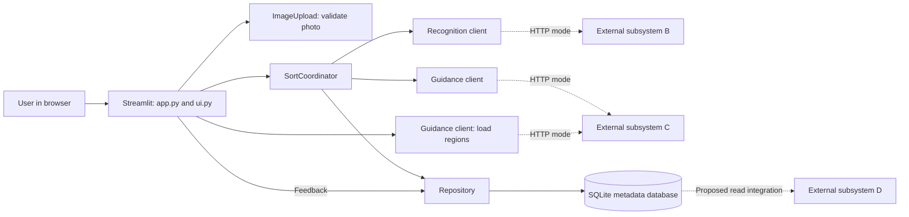
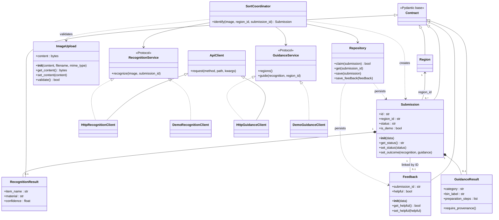

# ReSort: project explanation and presentation guide

## 1. What the project does

ReSort is a waste sorting assistant. A user chooses a city and uploads a photo of one item. The intended connected workflow identifies the item, asks a regional rules service how to dispose of it, and displays the result, preparation steps, explanation and available source information. Users can give feedback, download a completed result as JSON and start again.

**The implemented project is subsystem A, the public web interface.** It includes image validation, workflow coordination, HTTP clients, data contracts and local metadata storage. It does not contain an AI recognition model, a regional rules engine, a generated coach or an analytics dashboard.

| Subsystem | Responsibility | What exists in this repository |
| --- | --- | --- |
| A: Public interface | Upload, city selection, results, feedback, persistence | Implemented with Streamlit and Python |
| B: Recognition | Identify item, material, condition, confidence and special handling | HTTP client and response contract; external service must be supplied |
| C: Rules and coach | Supply regions and regional disposal guidance | HTTP client and response contract; external service must be supplied |
| D: Dashboard | Analyze stored submissions and feedback | Proposed shared database boundary; dashboard is external |

Streamlit is the actual framework used here. The code does not implement Flask routes or a separate JavaScript frontend.

## 2. Architecture



The browser interacts with Streamlit. Python on the server calls external services, so service tokens stay server-side. Demo clients replace HTTP clients when running examples.

## 3. One request, step by step

1. `Settings.from_env()` loads configuration. The default service mode is `demo`.
2. `app.py` gets a cached repository and guidance client. The region list is cached for five minutes.
3. The user selects a city and either uploads a photo or chooses an illustrated example.
4. `ImageUpload.validate()` checks nonempty content, the 10 MiB byte limit, JPG/JPEG/PNG extension, actual image format, image integrity and the 25-million-pixel limit.
5. On submission, `app.py` hashes the image bytes, region ID and example choice. The fingerprint helps retain the same request UUID during repeated actions within the session.
6. `SortCoordinator.identify()` validates again and creates a `Submission` in `processing` state.
7. `Repository.claim()` atomically inserts the request ID. If it already exists, the coordinator returns the saved record instead of calling recognition again. On a duplicate lookup, an unfinished record older than two minutes is marked failed.
8. The recognition client returns a validated `RecognitionResult`. A mismatched submission ID becomes a failure.
9. If recognition is uncertain, unsupported or below 0.60 confidence, the coordinator skips guidance. A `recognized` response below 0.60 becomes `uncertain`.
10. Otherwise, the guidance client receives the recognition facts and region ID. The coordinator checks the returned IDs and rejects ordinary `matched` guidance for an item flagged as special.
11. The outcome is saved in SQLite and displayed. Service failures are also saved, with a readable error message.
12. For completed submissions, the user can save yes/no feedback and download the JSON result. Reset clears the active result and replaces the uploader.

Exactly 0.60 confidence passes the threshold if the recognition status is `recognized`.

```mermaid
sequenceDiagram
    actor User
    participant UI as Streamlit app
    participant Flow as SortCoordinator
    participant DB as Repository / SQLite
    participant B as Recognition client
    participant C as Guidance client
    User->>UI: Select city, choose photo, submit
    UI->>UI: Validate photo and assign request UUID
    UI->>Flow: identify(image, region_id, submission_id)
    Flow->>Flow: Validate photo
    Flow->>DB: claim(submission)
    alt UUID already exists
        Flow->>DB: get(submission_id)
        DB-->>Flow: Existing submission
        Flow-->>UI: Existing result (possibly marked interrupted)
    else New UUID claimed
        Flow->>B: recognize(image, submission_id)
        B-->>Flow: RecognitionResult
        alt Recognized and confidence >= 0.60
            Flow->>C: guide(recognition, region_id)
            C-->>Flow: GuidanceResult
            Flow->>Flow: Check IDs and special handling
        else Uncertain or unsupported
            Flow->>Flow: Keep recognition outcome; skip guidance
        end
        Flow->>DB: save(submission)
        Flow-->>UI: Submission
    end
    UI-->>User: Display result or status
```

The sequence shows normal and duplicate processing. `ServiceError` during a new request changes the submission to `failed` before saving.

## 4. UML class diagram for your presentation

This overview keeps the main relationships readable. The complete diagram, including every project class, attributes, methods and exceptions, is in [class-diagram.mmd](class-diagram.mmd). Paste that file into a Mermaid-capable editor to render or export it as SVG/PNG for slides.



### How to read the UML

| Symbol | Meaning | Example |
| --- | --- | --- |
| `Parent <\|-- Child` | Inheritance | `Submission` inherits validation behavior from `Contract` |
| `Interface <\|.. Implementation` | Interface realization | Both recognition clients satisfy `RecognitionService` |
| `A --> B` | Navigable association | The coordinator holds a repository reference |
| `A ..> B` | Dependency | The coordinator uses an image passed into `identify()` |
| `A *-- B` | Composition | A submission contains an optional recognition or guidance result |
| `1`, `0..1`, `0..*` | Multiplicity | One submission has zero or one saved feedback row |
| `+` | Public member | `+validate()` is a public method |

The Python protocols use **structural typing**: the clients implement the required methods but do not explicitly inherit from the protocol classes. `SortCoordinator.__init__` is not annotated with those protocols; the diagram describes the collaborator roles it uses. Some diagram return/property types clarify runtime behavior where source annotations are absent. `_optional` means the value can also be `None`.

Region associations are logical links through string IDs, not nested region objects or database foreign keys. The `Submission`–`Feedback` association is backed by a SQLite foreign key. Only recognition and guidance are nested inside a submission. `app.py` and `ui.py` contain functions rather than application classes, so they appear in the architecture diagram instead of as invented UML classes. `Settings` is in the complete class diagram; `app.py` uses it to construct the collaborators.

## 5. Every class and its responsibility

### Assignment focus: three subsystem A classes

`ImageUpload`, `Submission` and `Feedback` each declare an explicit `__init__` and public getter/setter methods. `ImageUpload` now uses private-by-convention backing attributes (`_content`, `_filename`, `_mime_type`); its properties preserve existing calls such as `image.content`. Changing content or filename clears the previous MIME type so it can be checked again. Its constructor initializes state; `validate()` performs the separate file-validation step.

`Submission.__init__` and `Feedback.__init__` delegate to Pydantic with `super().__init__(**data)`. This initializes validated fields and default UUID/UTC timestamps while keeping existing JSON contracts and database restoration compatible. They enable validation on assignment as well. Setup is handled by the constructor and field defaults, so there is no redundant reset/initialize call.

For the video, show `ImageUpload.get_content()`/`set_content()`, `Submission.get_status()`/`set_status()` and `Feedback.get_helpful()`/`set_helpful()`. Submission mutations refresh `updated_at`; changing feedback refreshes its answer timestamp. IDs and creation timestamps have getter methods and are intentionally not given setter methods. Pydantic fields remain publicly accessible; the upload backing attributes use Python's underscore convention rather than enforced private access.

Example access through the assignment methods:

```python
submission = Submission(region_id="dortmund")
print(submission.get_id(), submission.get_status())
submission.set_status("failed")
submission.set_error("The recognition service was unavailable.")

feedback = Feedback(submission_id=submission.get_id(), helpful=True)
feedback.set_helpful(False)
print(feedback.get_helpful())
```

This example illustrates object methods only; feedback can be persisted only for a completed submission.

| Class | File under `src/waste_sorting/` | Responsibility |
| --- | --- | --- |
| `Contract` | `models.py` | Shared Pydantic base; rejects unknown input fields |
| `Region` | `models.py` | Region ID, display name and official source URL |
| `RecognitionResult` | `models.py` | Validated output from B, including confidence and special flag |
| `GuidanceResult` | `models.py` | Validated output from C, including preparation, explanation and provenance |
| `Submission` | `models.py` | One request, its state, timestamps, nested results and optional error |
| `Feedback` | `models.py` | A helpful/not helpful answer linked to a submission |
| `ImageUpload` | `uploads.py` | Holds image bytes in memory and validates the uploaded file |
| `UploadError` | `uploads.py` | A `ValueError` subclass for invalid images |
| `Settings` | `config.py` | Immutable configuration loaded from environment and `.env` |
| `Repository` | `storage.py` | Creates SQLite tables, claims requests and persists outcomes/feedback |
| `SortCoordinator` | `workflow.py` | Orchestrates validation, deduplication, recognition, guidance and storage |
| `RecognitionService` | `services/clients.py` | Protocol describing a recognition client |
| `GuidanceService` | `services/clients.py` | Protocol describing a region/guidance client |
| `ApiClient` | `services/clients.py` | Shared HTTP request, authentication, timeout and error behavior |
| `HttpRecognitionClient` | `services/clients.py` | Sends multipart images to B and validates the response |
| `HttpGuidanceClient` | `services/clients.py` | Loads regions and requests guidance from C |
| `ServiceError` | `services/clients.py` | A `RuntimeError` subclass for service/integration failures |
| `DemoRecognitionClient` | `services/demo.py` | Returns a chosen fixture; uploaded photos without a fixture are uncertain |
| `DemoGuidanceClient` | `services/demo.py` | Supplies fixed example regions and illustrative collection advice |

### Important model rules

- Recognition status: `recognized`, `uncertain` or `unsupported`. Confidence must be between 0 and 1; condition is `clean`, `soiled` or `unknown`.
- Guidance status: `matched`, `missing_rule` or `special`. `matched` requires a source URL, review date and positive rule version. The review date is currently a string, not a parsed date field.
- Submission status: `processing`, `completed`, `uncertain`, `unsupported` or `failed`.
- A submission is set to `completed` whenever guidance is attached, including `missing_rule` guidance. Completed means the workflow finished; it does not guarantee that a verified local rule exists.
- UUID strings are generated by the application, but the contract fields themselves are typed as `str`, not Pydantic UUID fields.

## 6. Demo mode versus connected mode

| Situation | What happens |
| --- | --- |
| Default `SERVICE_MODE=demo`, illustrated can/paper/bottle | Fixture recognition with 0.97 confidence; illustrative guidance with `missing_rule` status |
| Default demo mode, real uploaded photo | Validated and previewed; result is `uncertain` with confidence 0; guidance is skipped |
| `SERVICE_MODE=http`, real uploaded photo | Calls configured B and C services over HTTPS |
| HTTP mode, illustrated example | Still uses isolated demo clients; never sends the illustration to B |

There are no OpenAI calls, trained models or local recognition algorithms in A. The examples do not inspect image content to classify an object. Fixture advice is not verified city-specific advice. HTTP mode requires both service URLs to use HTTPS; bearer tokens are optional configuration values.

## 7. Storage, privacy and reliability

SQLite has two tables:

| Table | Saved data |
| --- | --- |
| `submissions` | ID, region ID, status, created/updated timestamps, demo flag and outcome JSON |
| `feedback` | Submission ID as primary/foreign key, helpful boolean and timestamp |

`outcome_json` contains the serialized `Submission`, including nested results and any safe error. SQLite stores boolean columns as integers and timestamps as UTC ISO strings. One feedback row is allowed per submission; a later answer updates it. Feedback is accepted only for completed submissions.

Image bytes and original filenames are not saved by the application repository. Bytes remain in process/session memory and, in connected upload mode, are forwarded to B using a generic filename. This implementation does not strip embedded image metadata; the proposed API contract assigns that responsibility to B. Hosting and upstream services need their own retention controls.

Atomic request claims prevent two workers sharing the database from starting the same UUID twice. SQLite WAL helps concurrent database access, and network calls do not hold a database transaction open. HTTP requests include an idempotency header, but B/C must implement their own deduplication as well. There are no automatic upstream retries. HTTPX timeouts apply to I/O phases, not a single total workflow deadline.

Service errors include timeouts, bad HTTP responses, invalid JSON, invalid response models and mismatched result IDs. The UI displays readable messages. Missing rules do not cause A to invent disposal advice. In connected mode, `missing_rule` displays a warning and explanation without an ordinary bin recommendation.

SQLite is suitable for this local deployment. The project documentation recommends a different repository such as PostgreSQL for distributed replicas; sharing SQLite over a network filesystem is not the intended deployment.

## 8. Files, libraries and running the project

| File or folder | Purpose |
| --- | --- |
| `app.py` | Entry point, dependency construction, session state, user actions, feedback and download |
| `src/waste_sorting/ui.py` | Page setup, artwork, sample image generation and result display |
| `assets/` | CSS styling and SVG illustration |
| `src/waste_sorting/` | Configuration, domain contracts, upload validation, coordination, storage and clients |
| `tests/` | Upload, HTTP, orchestration, persistence, concurrency and Streamlit UI tests |
| `docs/api-contracts.md` | Proposed B/C endpoint payloads and D integration boundary |
| `docs/schemas/` | Generated JSON schemas for five domain contracts |
| `scripts/export_schemas.py` | Regenerates schemas from the Pydantic models |
| `.streamlit/config.toml` | Theme, upload limit and server settings |
| `.env.example` | Example server-side configuration |
| `Dockerfile`, `compose.yaml` | Container setup, health check and persistent database volume |

Library roles: **Streamlit** builds the interface; **Pydantic** validates contracts and serializes JSON; **HTTPX** calls B/C; **Pillow** checks images and draws sample illustrations; **python-dotenv** loads `.env`; Python's built-in **sqlite3** handles persistence; **pytest** runs the automated tests.

Run from the project root in PowerShell after installing requirements in the virtual environment:

```powershell
.\.venv\Scripts\python.exe -m streamlit run app.py
```

Open `http://localhost:8501`. To run tests:

```powershell
.\.venv\Scripts\python.exe -m pytest -q
```

`docker compose up --build` is the alternative deployment path. Compose binds port 8501 to localhost and persists the database in a Docker volume. Public HTTPS needs hosting/proxy configuration.

## 9. How to demonstrate it to the teacher

1. Start the app in default demo mode and explain that you are demonstrating subsystem A.
2. Select **Try an example**, choose a city and a drink can, then submit.
3. Explain the displayed item, material, category, preparation steps, explanation and fixture confidence. Point out the example notice.
4. Give feedback and download the JSON to demonstrate persistence and the shared data contract.
5. Select **Sort another item**. Upload a real JPG/PNG to demonstrate validation and preview. Explain why demo mode returns uncertainty.
6. Show the architecture and simplified UML. Explain `SortCoordinator`, `Submission`, `Repository`, then the interchangeable clients.
7. Finish with the integration boundary: connecting real B/C services enables the intended real-photo workflow without replacing the UI or coordinator.

### A short opening you can say

> “Our project is ReSort, a public interface for a waste sorting system. The user chooses a city and provides a photo. Our subsystem validates that photo, coordinates recognition and regional guidance services, and presents the result. We separate the UI, workflow, data models, service clients and database access so each part has one clear responsibility. The current demo uses fixed examples; real recognition and regional rules are supplied by separate team services.”

### Questions the teacher may ask

| Question | Suggested answer |
| --- | --- |
| Where is the AI? | It belongs to subsystem B. This repository contains the client and validated contract, not an AI model. |
| Why separate recognition from guidance? | Identifying an item and deciding disposal under local rules are different tasks. The same item can require different guidance by region. |
| Why use protocols? | They describe the required client operations. Demo and HTTP clients provide the same operations, so the coordinator can use either. |
| What is dependency injection here? | `app.py` creates the repository and clients and passes them into `SortCoordinator`, rather than the coordinator constructing fixed implementations itself. |
| Where is inheritance used? | Domain contracts inherit from `Contract`, HTTP clients inherit from `ApiClient`, and custom exceptions inherit from built-in exceptions. |
| What happens when recognition is unreliable? | Uncertain/unsupported results and confidence below 0.60 skip the rules service and prompt the user for a better next step. |
| How are duplicate requests handled? | A stable session request UUID and an atomic SQLite claim reuse saved processing/results; HTTP idempotency headers are also sent upstream. |
| Is a completed result always verified? | No. Completed means guidance was returned. Its own status indicates matched, missing-rule or special guidance. |
| Are photos stored in the database? | No. Only metadata, outcomes and feedback are persisted by A. Connected mode forwards image bytes to B. |
| What design patterns are visible? | A repository encapsulates persistence; HTTP adapters hide external APIs; interchangeable clients provide strategy-like behavior; dependencies are injected into a coordinator. |
| How is it tested? | Image validation, mocked HTTP, workflow branches, IDs, errors, persistence, deduplication, concurrent fixture requests and a Streamlit UI flow have automated tests. |
| What still needs validation? | Real B/C integration, actual recognition accuracy and regional rules, deployed load/availability, full browser coverage and an independent accessibility audit. |

The existing validation record documents 33 passing tests and local browser checks. A 50-thread fixture test is not a production 50-user browser load test. See `docs/validation.md` and `docs/requirements.md` for the original acceptance boundaries.
